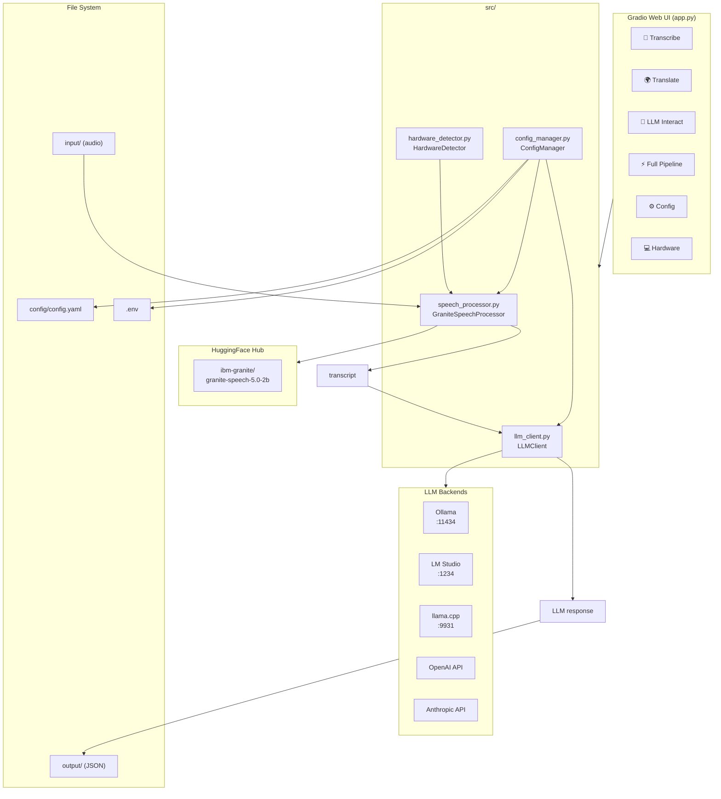

# Architecture

Detailed technical architecture for the IBM Granite Speech 5.0-2B Demo.

---

## System Architecture



---

## Module Descriptions

### `src/speech_processor.py`
Wraps the HuggingFace `AutoModelForSpeechSeq2Seq` + `AutoProcessor` APIs for Granite Speech 5.0-2B.

**Key design decisions:**
- **Lazy loading** — model weights are not loaded at import time; the first `.transcribe()` or `.translate()` call triggers loading.
- **Segment splitting** — audio longer than ~2 minutes (119 s) is split into frame-aligned chunks before decoding, per the model card recommendation.
- **Two-pass architecture** — consistent with the upstream model: CTC speech encoder produces embeddings → LLM backbone decodes text.
- **Device/dtype flexibility** — any combination of CUDA / MPS / CPU and bfloat16 / float16 / float32 is supported.

### `src/hardware_detector.py`
Interrogates the host to produce a `HardwareProfile` with recommendations.

**Detection strategy:**

| Check | Method |
|---|---|
| CPU cores | `psutil.cpu_count()` with stdlib fallback |
| RAM | `psutil.virtual_memory()` with `/proc/meminfo` fallback |
| CUDA GPUs | `torch.cuda.get_device_properties()` per device |
| Apple Silicon | `platform.machine() == "arm64"` + `torch.backends.mps.is_available()` |

**Recommendation logic:**

```
if CUDA GPU with ≥3.5 GB free VRAM → device=cuda, dtype=bfloat16
elif Apple Silicon MPS available   → device=mps,  dtype=float16
else                                → device=cpu,  dtype=float32
```

### `src/llm_client.py`
Provides a unified `LLMClient.chat(messages) → LLMResponse` interface.

**Inheritance hierarchy:**
```
LLMClient (ABC)
├── OpenAICompatibleClient     ← shares urllib-based POST logic
│   ├── OllamaClient
│   ├── LMStudioClient
│   ├── LlamaCppClient
│   └── OpenAIClient
└── AnthropicClient            ← uses Anthropic Messages API format
```

All HTTP calls use only Python stdlib (`urllib.request`) to avoid the `openai` / `anthropic` SDK packages as hard dependencies.

### `src/config_manager.py`
Three-layer configuration merging (lowest → highest priority):

```
config/config.yaml  →  .env file  →  environment variables
```

A module-level singleton (`_manager`) is created on first call to `get_config()` and cached for the process lifetime. Call `reload_config()` to force a disk re-read.

---

## Data Flow — Full Pipeline

```
Audio file (WAV/MP3/FLAC)
  │
  ▼
[torchaudio.load] → resample to 16 kHz mono
  │
  ▼
[_split_segments] → ≤119 s chunks
  │
  ▼ (for each chunk)
[AutoProcessor] → text prompt + audio features
  │
  ▼
[GraniteSpeechSeq2Seq.generate] → token IDs
  │
  ▼
[tokenizer.decode] → segment text
  │
  ▼
join(" ") → full transcript
  │
  ▼
[LLMClient.chat] → LLM response
  │
  ▼
output/result_YYYYMMDD_HHMMSS.json
```

---

## Configuration Reference

| Variable | Config key | Default | Description |
|---|---|---|---|
| `SPEECH_DEVICE` | `speech.device` | `auto` | Inference device |
| `SPEECH_DTYPE` | `speech.dtype` | `auto` | Weight precision |
| `SPEECH_MODEL` | `speech.model_name` | `ibm-granite/granite-speech-5.0-2b` | HF model ID |
| `SPEECH_MAX_NEW_TOKENS` | `speech.max_new_tokens` | `512` | Max tokens per segment |
| `LLM_BACKEND` | `llm.backend` | `ollama` | Active LLM backend |
| `LLM_OLLAMA_MODEL` | `llm.ollama.model` | `granite3.3:8b` | Ollama model |
| `LLM_OPENAI_MODEL` | `llm.openai.model` | `gpt-4o-mini` | OpenAI model |
| `OPENAI_API_KEY` | — | — | OpenAI secret key |
| `ANTHROPIC_API_KEY` | — | — | Anthropic secret key |
| `APP_PORT` | `app.server_port` | `7860` | Gradio server port |

---

## Extension Points

### Adding a new LLM backend

1. Create a class that extends `LLMClient` in `src/llm_client.py`:
   ```python
   class MyBackendClient(LLMClient):
       backend_name = "mybackend"
       def _send(self, req: LLMRequest) -> LLMResponse:
           ...
   ```
2. Register it in `_BACKEND_MAP`:
   ```python
   _BACKEND_MAP["mybackend"] = MyBackendClient
   ```
3. Add a section to `config/config.yaml` under `llm:`.
4. Set `LLM_BACKEND=mybackend` to activate.

### Using a fine-tuned speech model

```yaml
# config/config.yaml
speech:
  model_name: "your-org/your-finetuned-model"
```
The model must be compatible with `AutoModelForSpeechSeq2Seq` and `AutoProcessor`.

### Processing audio programmatically

```python
from src.speech_processor import GraniteSpeechProcessor
import numpy as np

processor = GraniteSpeechProcessor()
waveform = np.random.randn(16000).astype(np.float32)  # 1 second of noise
result = processor.transcribe(waveform)
```
