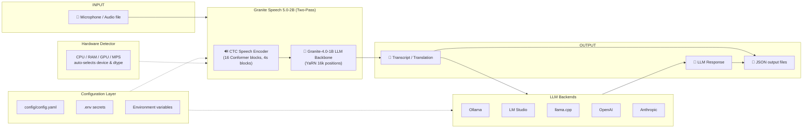

# IBM Granite Speech 5.0-2B — Demonstration Application

A comprehensive, end-to-end demonstration application for **IBM Granite Speech 5.0-2B** that integrates speech processing with configurable LLM backends and hardware-aware optimisation.

## Overview

| Feature | Detail |
|---|---|
| **ASR model** | [ibm-granite/granite-speech-5.0-2b](https://huggingface.co/ibm-granite/granite-speech-5.0-2b) |
| **Model licence** | Apache 2.0 |
| **Task** | Multilingual ASR + Speech Translation |
| **Languages** | EN, FR, DE, ES, PT, JA (bidirectional) + EN → IT, ZH |
| **LLM backends** | Ollama, LM Studio, llama.cpp, OpenAI, Anthropic |
| **UI** | Gradio web application |
| **Python** | 3.10 – 3.12 |

---

## Architecture



---

## Project Structure

```
granite-speech5-test/
├── app.py                  # Gradio demo application (entry point)
├── requirements.txt        # Python dependencies
├── .env.example            # Environment variable template
├── config/
│   └── config.yaml         # Application configuration
├── src/
│   ├── speech_processor.py # Granite Speech 5.0-2B wrapper
│   ├── hardware_detector.py# Hardware capability detection
│   ├── llm_client.py       # Multi-backend LLM abstraction
│   └── config_manager.py   # Configuration management
├── tests/
│   ├── test_speech_processor.py
│   ├── test_hardware_detector.py
│   ├── test_llm_client.py
│   └── test_config_manager.py
├── scripts/
│   ├── setup.sh            # One-time environment setup
│   ├── start.sh            # Launch app in background
│   ├── stop.sh             # Graceful shutdown
│   └── cleanup.sh          # Remove artefacts / venv
├── input/                  # Put audio files here
├── output/                 # JSON results written here
└── Docs/
    ├── Quickstart.md
    └── Architecture.md
```

---

## Quick Start

```bash
# 1. Clone / open the project
cd granite-speech5-test

# 2. Setup (creates .venv, installs deps, copies .env.example → .env)
bash scripts/setup.sh

# 3. Configure (select your LLM backend)
nano config/config.yaml          # or edit .env

# 4. Launch
bash scripts/start.sh
# → http://localhost:7860

# 5. Stop
bash scripts/stop.sh
```

See [`Docs/Quickstart.md`](Docs/Quickstart.md) for detailed instructions.

---

## Hardware Requirements

| Setup | Minimum | Recommended |
|---|---|---|
| **CPU** | 8-core, 8 GB RAM | 16-core, 16 GB RAM |
| **GPU (CUDA)** | 4 GB VRAM | 8 GB VRAM |
| **Apple Silicon** | M1 (8 GB unified) | M2 Pro / M3 (16 GB) |
| **Storage** | 6 GB free | 10 GB free |

The [`HardwareDetector`](src/hardware_detector.py) automatically selects device and dtype:

| Device | dtype | ~Memory |
|---|---|---|
| CUDA GPU | bfloat16 | ~4 GB VRAM |
| Apple Silicon (MPS) | float16 | ~4 GB unified RAM |
| CPU only | float32 | ~8 GB RAM |

---

## Supported LLM Backends

| Backend | Key | Default URL | Notes |
|---|---|---|---|
| **Ollama** | `ollama` | `http://localhost:11434/v1` | Free, local |
| **LM Studio** | `lmstudio` | `http://localhost:1234/v1` | Free, local GUI |
| **llama.cpp server** | `llamacpp` | `http://localhost:9931/v1` | Lightweight |
| **OpenAI** | `openai` | `https://api.openai.com/v1` | Requires API key |
| **Anthropic** | `anthropic` | `https://api.anthropic.com` | Requires API key |

Switch backends without code changes:
```yaml
# config/config.yaml
llm:
  backend: "ollama"   # change to "openai", "anthropic", etc.
```

Or at runtime:
```bash
LLM_BACKEND=openai bash scripts/start.sh
```

---

## Usage Examples

### Python API

```python
from src.speech_processor import GraniteSpeechProcessor
from src.llm_client import build_llm_client
from src.hardware_detector import detect_hardware

# 1. Detect hardware
hw = detect_hardware()
print(hw.summary_str())

# 2. Transcribe
processor = GraniteSpeechProcessor(device=hw.recommended_device)
result = processor.transcribe("input/meeting.wav")
print(result.text)
print(f"Real-time factor: {result.realtime_factor:.1f}×")

# 3. Translate (French → English)
result = processor.translate("input/fr_speech.wav", source_language="fr")
print(result.text)

# 4. Post-process with LLM
llm = build_llm_client("ollama", model="granite3.3:8b")
response = llm.chat([
    {"role": "user", "content": f"Summarise: {result.text}"}
])
print(response.text)
```

### Configuration via Environment Variables

```bash
# Switch LLM backend
export LLM_BACKEND=openai
export OPENAI_API_KEY=sk-...
export LLM_OPENAI_MODEL=gpt-4o-mini

# Force CPU inference
export SPEECH_DEVICE=cpu
export SPEECH_DTYPE=float32

# Custom Ollama model
export LLM_OLLAMA_MODEL=llama3.2:3b
```

---

## Running Tests

```bash
source .venv/bin/activate

# All tests (no GPU/internet required)
python -m pytest tests/ -v

# Coverage report
python -m pytest tests/ --cov=src --cov-report=term-missing
```

---

## Licence

This application is released under the **MIT Licence**.  
The IBM Granite Speech 5.0-2B model is licensed under **Apache 2.0** — see the [model card](https://huggingface.co/ibm-granite/granite-speech-5.0-2b) for full terms.

---

## References

- Model card: https://huggingface.co/ibm-granite/granite-speech-5.0-2b  
- Granite Speech Models: https://github.com/ibm-granite/granite-speech-models  
- Granite Speech library: https://github.com/ibm-granite/granite-speech
